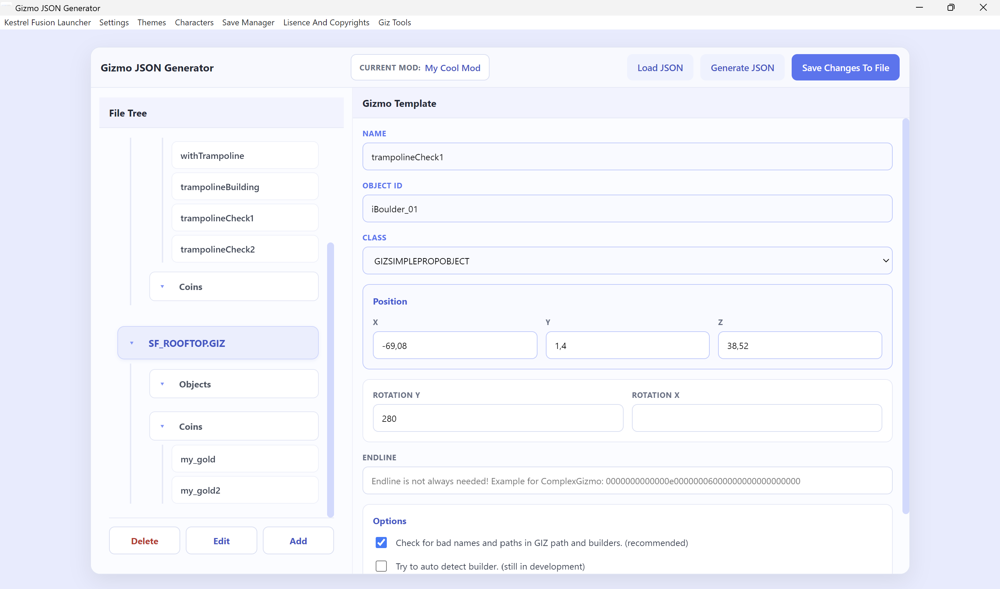
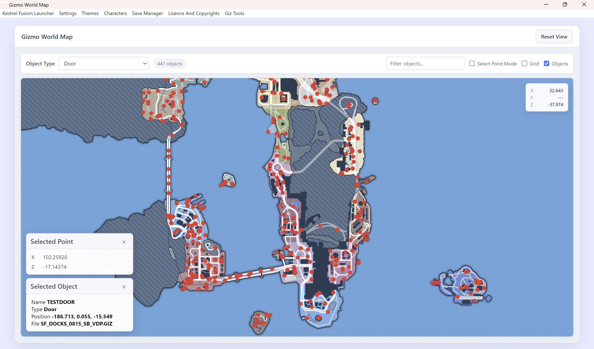
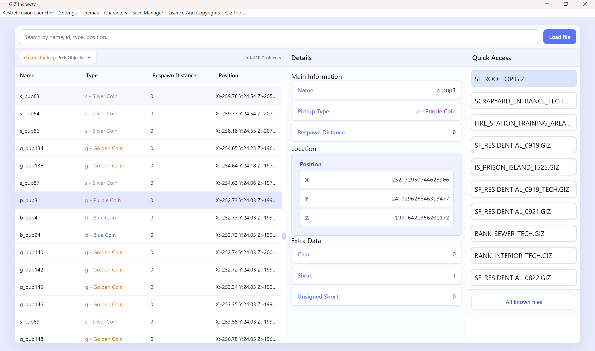

# Kestrel-Gizmo-Tools-Addon

This is a work in progress gizmo toolset for Lego City Undercover. It aims to simplify the process of analysing existing giz files, finding the right files to add new entries and converting the user input to work with the kestrel fusion launcher map-manager logic.  

---

## Table of Contents

- [Quick Overview](#quick-overview)
- [Installation](#installation)
- [How to use](#How-To-Use)
- [Documentation](#documentation)
    - [All Features](#All-Features)
    - [Giz File Structure](#Gizmo-File-Structure)
- [Credits](#credits)

---

## Quick Overview

It exists out of three programs that can help you in the gizmo spawning process (or just discover more about the objects in the city):
- A json generator, which represends the json file contents used by the kestrel fusion map-manager in a clean way and makes it easy to add/edit/delete objects or coins without ever touching the raw json files.  

- A interactive world map, which can show objects that the game itself spawns with some usefull information and it can help you find the right coördinates for your new gizmo.  

- A gizmo file reader, which can fully read gizmo files and the different sections in detail so it also provides more then enough information to spawn gizmo's yourself or discover about the more complex gizmo sections.  

## Installation

The installation is really easy:
- Unzip the download.
- Find the path to your **kestrel fusion launcher app directory**.  
*Hint: if you don't know how to find it, there is a button in the Kestrel Fusion Launcher called `Create Mod` that opens a explorer window that if you go one directory back leads you to the target app folder.*
- Drag the unzipped addons folder into the app directory.
- And the tools are installed!

## How to use

In general the addon is very easy to use. It adds a new tab in the menu top bar of Kestrel Fusion Launcher that has 3 sub tabs.
<!--  -->
Any of the three options opens a new window for the corresponding tool.  
*See the full feature set with some of the more important instructions below.*

## Documentation

### All Features

Click [here](docs/tools/object-json-generator.md) for full instructions on the `Object JSON Generator`.  
Click [here](docs/tools/interactive-world-map.md) for full instructions on the `Interactive World Map`.  
Click [here](docs/tools/giz-file-reader.md) for the full instructions on the `GIZ File Reader`.

### Gizmo File Structure

Click [here](docs/GIZ_Format_Documentation.md) for the documentation about the gizmo files and how the entries as far as we know are structured.  
> [!WARNING]
> The docs are not completed yet and some is also a bit outdated!
> This will be improved over time.

## Credits

- [Lego City Undercover Decompilation](https://github.com/Nintendocustom/Lego-City-Undercover-Decompilation) - Thanks to Hannes and his project who helped with the gizmo research
- [OpenSeadragon](https://github.com/openseadragon/openseadragon) - Lib for the interactive world map control