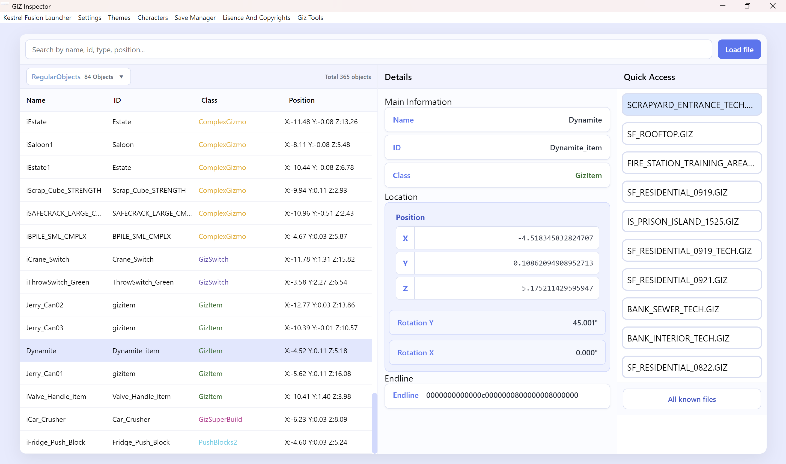

# Giz File Reader

The provides you with a lot of information about all the gizmo sections in the giz files. This can load **all the information ever needed to write your own gizmo's**. It can also load a lot of gizmo sections that are not supported yet in the kestrel fusion launcher map-manager. However it is interesting to see what possibilities there are in the future for a more extensive map-manager.  

> [!WARNING]
> Builders are not supported yet!
> They can be loaded and to some extend they can work well but i can't promise anything!

---

## Table of Contents

- [Loading Files](#loading-files)
- [GIZ File Sections](#giz-file-sections)
- [Details Page](#details-page)

---

## Loading Files

The first step is loading a file that the program can read. There are three options to do this:
- **Manually load a file** in the top right corner there is a button called `Load file`. This opens a **selection window** where you can select a .GIZ file to load directly. This file will open and it get's saved in the recent cache for quick access later and the main cache that functions as a big library.
- **Choose a file from quick access** the program by default already loads the top file from quick access after start. This list can get a max size of 10 entries where it saves all the latest files loaded. A single click is enough to read the selected file.
- **Known files** there is a button called `All known files` as the last entry of the quick access which opens a **menu to find more saved files**. It saves every file seen but luckily you **don't have to open every single .GIZ file yourself**. It has two buttons at the top called `Auto Game Scan` and `Manual Folder Scan` who can scan through folders to find .GIZ files and save them into this big list. The `Auto Game Scan` uses your game path to save all .GIZ files for the **city and all the files for the standalone levels**. Next to it there is also the `Manual Folder Scan` button that opens a **selection window** that asks for a directory which it will scan for .GIZ files and save those.  
The files in the menu can be opened by scrolling through the list but there is also a search bar that filters for **matching text in the name or path**.

## GIZ File Sections

After loading a file the left list UI will be filled with the entries of the first gizmo section in the current file. In the top left corner there is a **pop up menu to select any of the sections** in the current giz file. Every section has it's own color to make them easy to recognise. Clicking a section will change the list and also some of the preview information in the list itself. **Clicking any entry in the list will load the data into the details page** right of it. In general for the current map-manager the *GizmoPickup* and *RegularObjects* sections are the most important because those are the only sections that can be spawned.

## Details Page

In the middle of the window there is a details page. By default it always shows the **first entry in the currently loaded section**. When clicking a new entry in the list it will show that in full detail. The details UI get's **generated specifically for what the entry has in data**. Even though every section is different and gives different data back there is a structure in it.
- **At the top `Main Information`** there is known data with clear labels. For these I am pretty sure what they mean and do.
- **In the middle `Position`** there is the **position of the object** (or multiple if there are multiple positions) with the **rotation** and in the **rare case that there is a attached object** it also shows it here with the name and the position.
- **At the bottom `Extra Data`** there is the left over data. **This is writting in pure variables** so you need some knowledge about computer variables to understand it but luckily it is **not necessary at all to use the tool**. For the regularObjects the extra data is stored as a endline that can be copied into the [Object JSON Generator](./object-json-generator.md) that could be needed sometimes.
> [!WARNING]
> Do NOT copy the endline into the json file manually!
> The Object JSON Generator transforms the endline to the right length for the current map-manager so by itself from this tool it does not work!