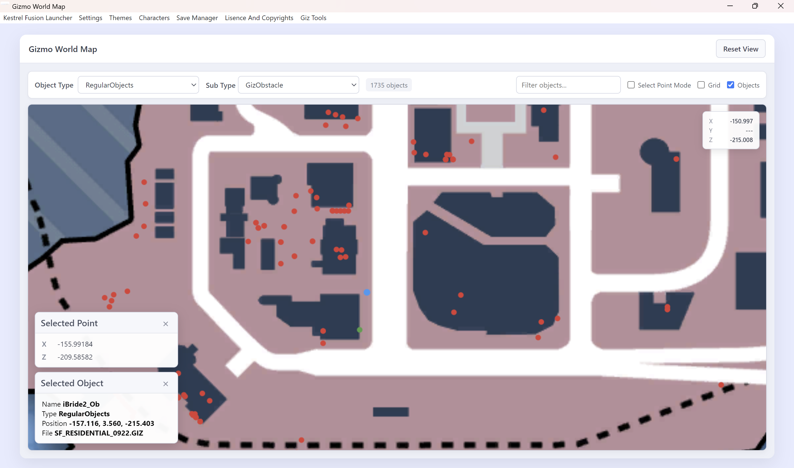

# Interactive World Map

The Interactive World Map is a usefull tool for spawning your own gizmo's but it is also just cool to find the existing gizmo's in the city for everybody who would be interested in that.  

> [!NOTE]
> Support for level maps is planned for the future.

---

## Table of Contents

- [Map Control](#map-control)
- [Loading Objects](#loading-objects)
- [Reading Coördinates](#reading-coördinates)

---

## Map Control

Controlling the map should be fairly straight forward. 
- The **scroll wheel** on your mouse zooms in or out on the map.
- A **double clickking** on the right or left of your mouse also zooms in a bit. 
- **Holding left click and moving the mouse** gives you the possibility to move around on the map.
- The `Reset View` button in the right top corner resets the map to the base position again.
- There is also the option to **overlay a grid** with a `Grid` checkbox in the right top corner.

## Loading Objects

After starting the map for the first time a cache is build of every gizmo in the city included currently in all the lego city giz files.  
In the left top corner there is a bar called `Select type...` where a specific gizmo type can be selected which will be **shown on the map as red dots**. For *GizmoPickup* and *RegularObjects* there is also a subtype bar that specifies the type of object that get's loaded.  
**Red dots can be clicked** to show some some basic information in the left bottom corner that can be used to find the file for the [Giz File Reader](./giz-file-reader.md) or find some other information about the object located there. The program reads the **entry located closed near the mouse within a certain small range**. To make sure it also works well in the case multiple objects are located very closely **clicking multiple times close to objects it loops through all objects in range**.

> [!WARNING]
> I don't know if it is because of the coördinate system or if it has something to do with the map itself but some **positions seem to be of a little bit**
> The position given by the object details itself is exactly correct though.

## Reading Coördinates

This is a very usefull tool for writing new Gizmo's in multiple ways:
- **Finding ingame objects** the map can be used (by map location or by coördinates) to know more about **objects found in the game itself**. It gives the name, file and coördinates of the target object to confirm it is the right object and to find all the information to spawn it in the [Giz File Reader](./giz-file-reader.md).
- **Finding the near location of specific coördinates** a small overlay on top of the map in the right top corner gives a **live view of the position of the mouse in ingame coordinates**.
- **Gathering the location for your own gizmo's** in the top right corner there is a checkbox called `Select Point Mode` which when activated gives you the ability to **set your own blue dot by clicking the left mouse button**. This position is then saved in the `Selected Point` overlay box so you can copy it to spawn your own gizmo at that position. **Every click overwrites the one before** but unchecking the `Select Point Mode` checkbox **keeps the last selected point and freezes the blue dot**.

> [!NOTE]
> There is no Y (height) coördinate on the map so i would reccomend to find out the height used by other objects in the specific area with help of the [Giz File Reader](./giz-file-reader.md) and the file name given in the details when clicking a object.