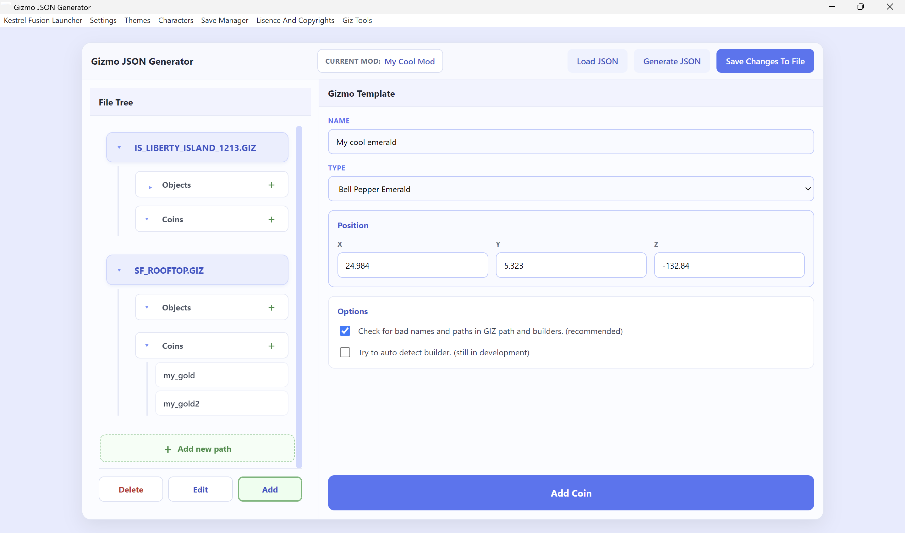

# Object JSON Generator

This tool is designed to make the required json files for the **Kestrel Fusion Launcher Map-Manager** to spawn gizmo's easy to handle.  

> [!NOTE]
> Knowing well how changes are saved is important!  
> See: [Saving Changes](#saving-changes-important)

---

## Table of Contents

- [Loading Mods](#loading-mods)
- [Using File Tree](#using-file-tree)
- [Gizmo Form](#gizmo-form)
- [Saving Changes](#saving-changes-important)

---

## Loading Mods

First it is important to know how to load the mod in which you want to spawn a gizmo. There are two options to do this:
- **Loading a existing mod:**
The button on the top called `Load JSON` can be used to load a existing mod into the program. When it is clicked it opens a **selection window** that
prompts the user to select a file called "*Objects.json*". This is used by the map-manager to find out what kind of objects it needs to load into the
world. After selecting the file the program **loads the ui with the existing data** currently in the json file.
- **Setting a mod up for the map-manager:**
The button besides it called `Generate JSON` also opens a **selection window** but prompts the user to open a file called "*mod.json*". This is the configuration file that kestrel fusion launcher uses to find mods. So select the *mod.json* of the mod you are making and the program will do four things: **It patches the mod.json for map-manager compatability, it creates a "*map*" folder in the mod, it creates a "*Objects.json*" file and it also opens the *Objects.json* for use.**  
This is the complete setup a mod needs to spawn new gizmo's so you can start with ease.

## Using File Tree

The file tree gives a overview of the current data inside the json file. It shows the hierarchy of the file to make it more clear. The file tree has three modes:
- **Delete:**
This mode makes a `-` appear after every header or entry. Clicking on it does as expected, it deletes the entry or header from the structure, but it does **ask for confirmation before deleting** the entry. *Deleting a header (shows in the tree as a path) does also delete all entries under it.*
- **Edit:**
This is the "default" setting to some extent already. Clicking any entry while **no mode is selected acts as the edit mode**. It is not completely useless though because clicking headers without a mode activated just collapses the tree under it so **edit mode is needed for header editing**.
- **Add:**
The add mode also works as you can expect. The `+` at the objects or coins gives you a **new blanck page for a extra object or coin**. It is also possible to **add another header** which can be added by **scrolling down to the bottom** where now a new **green ghost button** called `+ Add new path`. This gives a new blanck panel for adding a header.

## Gizmo Form

The biggest box on the right is the form to collect the entry data or edit existing data. The boxes get generated based on what kind of data is needed from the user. All **this data can be found for existing ingame gizmo's in the [Giz File Reader](giz-file-reader.md)** but not all boxes are required to fill in, **only the blue boxes need to be filled in**.  
There are always **two checkboxes at bottom** of which the first one is selected by default. This box checks if the given paths are actually valid, existing paths so it is **recommended to keep checked** because of the probability of typo's or other small errors. The second box is still in development so sadly finding the right builder is not automated at the moment. You can try to guess it or load a builder in the [Giz File Reader](giz-file-reader.md) but **builders are much more likely to throw errors and not load well at all** (they are also not included in the standard cache).  
All the way down there is also a big blue button which **saves the data in the form**. I would recommend to learn more about it down below.

## Saving Changes (IMPORTANT!)

Saving changes is actually done on two levels:
- **Ram:**
While add/editing/deleting objects the big blue button in the form is used which **saves the changes in ram**. So no file is written during this time and closing the app makes all edits dissapear again. This is what you **use during work on the file** and after that you go to the step below.
- **File:**
In the top right corner there is a button called `Save Changes To File`. This writes all the changes made in ram to the *Objects.json* for the selected mod. If there are any problems while saving, a backup of the original *Objects.json* file is saved in the *app/addons/Gizmo Tools* folder.
> [!WARNING]
> After loading a mod the *Objects.json* is saved in a backup. If there is corruption, loading the bad file again will wipe the good backup.  
> Keep that in mind!